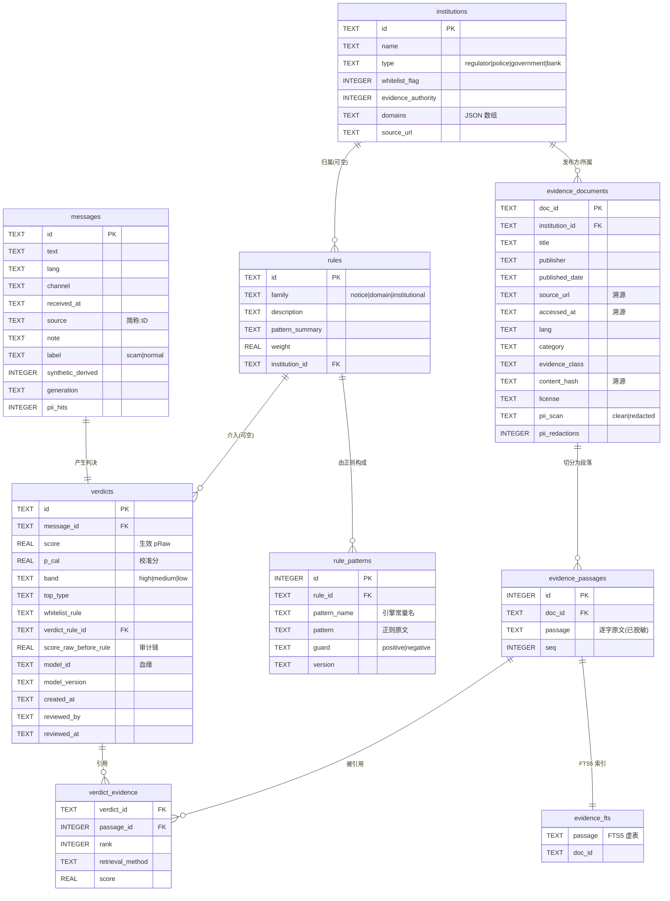
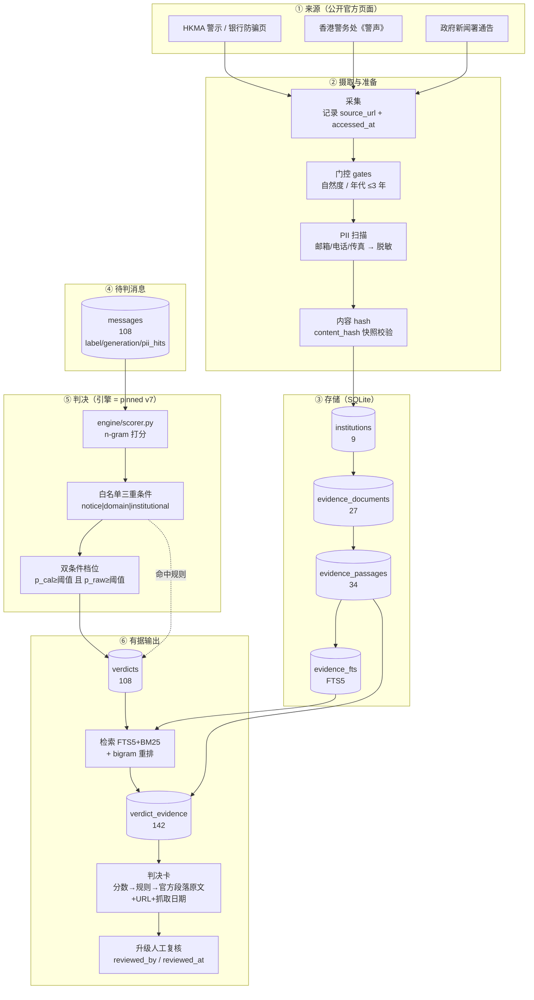

# 行动项 · 设计产物与收尾清单（2026-09-29）

> 对象：`P3NN4L/MAIB7050GP`
> 基准：`MAIB7050_Group_Project_Guidelines.pdf` §1.5 / §1.6 / §2.3 / §2.4 / §2.9
> 本文件只含建议，未修改任何代码。
> 前置：上一份 `EXTERNAL-REVIEW-2026-09-29.md` 的 7 条已全部落地（核验见 §6）。

---

## 摘要：只剩三件事

| # | 事项 | 依据 | 成本 |
|---|---|---|---|
| 1 | **补 ERD + 架构/血缘视图** | §2.4 交付物明写 "Design artefacts: ERD or schema, … architecture and lineage view" | 半天（本文件已给出可直接用的图） |
| 2 | **两个数据库合一** | 判分人会打开 `data/guardkit_course.db`，那里**没有 verdicts / verdict_evidence / FTS** | 10 分钟 |
| 3 | **60 例评估集** | §2.4 "Evaluation evidence" + §1.6 "documented set of representative and difficult test cases" | 2–3 天 |

**其余一律不要再加。** 见 §5「停止清单」。

---

## 1. 🔴 ERD（§2.4 明确要求的交付物，目前缺失）

复核在文件树里**未找到任何 ERD、schema 图或架构图**。`docs/` 下只有 `match.md` / `plan.md` / `proposal.md` / `queries.sql`。

### 1.1 实体关系图（按 `guardkit_evidence.sqlite` 实际 schema 绘制）



**这张图本身就能讲三个设计论点**（报告里可直接引用）：

1. **两段式结构**：左侧是**证据侧**（机构 → 文档 → 段落），右侧是**判决侧**（消息 → 判决），`verdict_evidence` 是唯一的桥。这个桥的位置不是随意的——它保证「每条判决必须能指回具体段落」，而不是指回整篇文档。
2. **规则是可查询的数据**：`rules`（族）→ `rule_patterns`（正则原文 + 方向 + 版本）两级。这支持「白名单调整后能否定位是哪条规则在哪个版本改变了误报」。
3. **审计链完整**：`verdicts` 同时保留 `score`（生效值）、`score_raw_before_rule`（规则介入前）、`verdict_rule_id`（哪条规则介入）——「规则改了什么」可被 SQL 复原。

### 1.2 怎么出图（不需要新依赖）

- **GitHub 直接渲染**：把上面的 ```mermaid 块放进 `README.md` 或新建 `docs/erd.md`，GitHub 会渲染成图；
- **要放进报告（PDF）**：在 <https://mermaid.live> 粘贴同一段代码，导出 SVG/PNG（A4 可读），再嵌进报告 §Data architecture；
- 若偏好 dbdiagram：把 `guardkit_evidence.sqlite` 的 DDL（见 §7 附录）粘进 <https://dbdiagram.io> 即可。

> 报告 §2.7 要求图「readable at normal viewing size」，导出时注意字号不要缩太小。

---

## 2. 🔴 架构与血缘视图（§2.4 同样要求）

课程原文：*"**Design artefacts** — ERD or schema, document or JSON structure, **architecture and lineage view**…"* 以及 §1.6 *"**Integration and lineage** — A clear path from source data through transformation and storage to query or output."*

ERD 讲的是**静态结构**，血缘图讲的是**数据怎么流动**。两者都要。



**这张图的三个用途**：

1. **答辩时指着它讲**：15 分钟演示里「Working end-to-end demonstration with evidence」占 5 分钟，这张图是最好的骨架；
2. **回答预设问题**：课程 §2.10 列了会问的问题——「a result came from / why a field was chosen / what happens when retrieval fails」——这张图上每一格都有答案；
3. **它同时是「血缘」证据**：每一跳的溯源字段（`source_url` / `accessed_at` / `content_hash` / `model_id` / `verdict_evidence.retrieval_method`）都标在图上。

> 两个图都建议单独放 `docs/design.md`，并在 `README.md` 的「仓库结构」表里加一行指过去。

---

## 3. 🔴 两个数据库必须合一

### 现状

| | `guardkit_evidence.sqlite`（205 KB） | `data/guardkit_course.db`（94 KB） |
|---|---|---|
| institutions | **9** 行，主键 `id` | **5** 行，主键 `institution_id` |
| evidence_documents | **27** | **25** |
| messages | **108** | **100** |
| verdicts | ✅ 108 | ❌ 无表 |
| verdict_evidence | ✅ 142 | ❌ 无表 |
| evidence_fts | ✅ FTS5 | ❌ 无 |

### 为什么必须处理

判分人打开 `data/` 会看到两个 `.db`，必须**猜**哪个是产品本体。若他打开小的那个，看到的是「没有判决表、没有证据链接、没有检索层」——直接命中 §2.9 的 *"missing core layers"* 判据。

### 修法（二选一）

- **推荐**：删掉 `data/guardkit_course.db`，并在 `README.md` 写死一句：
  > **唯一产品数据库：`guardkit_evidence.sqlite`。`data/*.jsonl` 是它的源数据，由 `src/build_db.py` 重建。**
- 或者：若 `guardkit_course.db` 是必需的中间产物，重命名成 `guardkit_course.source.db` 并在 README 说明它**不是**产品数据库。

同时建议在 README 顶部加一行「marker 从这里开始」的三步路径（`build_db.py` → `run_demo.py` → `open demo/verdict_cards.html`），把判分人直接引到正确的库。

---

## 4. 检索：已完成，补两句说明即可

复核确认已落地，且实现方式正确：

```
evidence_fts : CREATE VIRTUAL TABLE evidence_fts USING fts5(passage, doc_id UNINDEXED, tokenize='unicode61')
verdict_evidence.retrieval_method 样例值 = 'fts5-bm25-docagg'
verdict_evidence.score 样例值 = 7.4412   （-bm25，越大越相关）
```

**这已经满足 §1.6 的 "Working keyword, metadata, semantic or hybrid retrieval appropriate to the use case"。**

报告里补三句话就够（不用再加代码）：

1. **为什么用 FTS5 而不是 embedding**——课程原文：*"Semantic retrieval should use embeddings **when they add justified value**."*
   你们的用例是**官方通告的短段落检索 + 精确术语命中**（「供應商」「收款戶口」「冷靜期」），关键词检索在这个场景下更可解释、可复现、零依赖。**如实写「本用例下 embeddings 未带来可论证的增量」，是符合课程要求的正当结论**，不是偷懒。
2. **`retrieval_method` 字段的存在本身就是证据**——它让「这条判决用哪种检索找到依据」可被 SQL 查询，将来换方法可对比。
3. **检索失败的处置**——`run_demo.py` 里「未检索到足够相关的官方段落时如实显示，不硬凑依据」这一句，要写进报告的 evaluation 节，它是「unsupported output」的反面。

> 若时间富余，加一组小对比（metadata-only vs FTS5，各 20 条测试查询的 P@1）即可，**不必做 embedding**。

---

## 5. 停止清单（不要再做的）

上一轮复核后已超额完成。以下项目**对课程得分没有实质帮助**，建议停手：

| 项 | 为什么可以不做 |
|---|---|
| `evidence_passages` 段落密度提升 | 文档门槛（≥20）已过；再切段只影响检索区分度，不影响得分点 |
| 检索三方对比（含 embedding） | §1.6 只要求 working retrieval；「embeddings 是否 justified」用文字论证即可 |
| `rules` 进一步规范化 | 已是两级可查询结构，够了 |
| 判决卡 UI 美化 | §1.1 明写「visual polish does not compensate」 |
| 引擎相关任何改动 | pinned 依赖，动它反而不利（先期工作申报已写死） |

**力气应该花在**：§1 的 ERD、§2 的血缘图、§6 的评估集、以及把已有的治理素材写进报告。

---

## 6. 上一份复核的落地核验（供答辩时自证）

| 原建议 | 现状 | 证据 |
|---|---|---|
| P0-1 verdict↔evidence schema 链接 | ✅ | `verdict_evidence` 表（142 行），双向外键 + `rank`/`retrieval_method`/`score` |
| P0-2 硬门槛 | ✅ | `evidence_documents` 27（≥20）；`messages` 108（≥50） |
| P1-1 检索非 SQL | ✅ | `evidence_fts` FTS5 + `retrieval_method='fts5-bm25-docagg'` |
| P1-2 `match.md` 死链 | ✅ | 8,505 → 9,631 bytes，已重写 |
| P1-3 PII 无实作 | ✅ | `pii_scan` / `pii_redactions` / `messages.pii_hits` + `src/textproc.py` |
| P2-1 rules 应为数据 | ✅ | `rule_patterns`：正则原文 + `guard` 正负向 + 版本 |
| P2-2 白名单覆盖原始分 | ✅ | `score_raw_before_rule` |
| 附带 | ✅ | `verdict_rule_id` FK、`license`、`evidence_class`、`institutions.domains`、`docs/queries.sql` |

**另有一处设计值得在报告里点出来**（复核认为很有说服力）：

- `messages` 表把「数据来源合规」做成了**字段级证据**：`source`（来源集:ID）、`label`（期望标签）、`synthetic_derived`（是否含 LLM 成分）、`generation`（real / llm_rewrite_v3_blind / human_written_demo）、`pii_hits`。这直接对应 §1.5 的「Simulated or synthetic data … must be clearly labelled and justified」和 §2.11 的 AI 申报要求。**一句话就能讲清楚，比任何泛泛声明都有力。**

另：`verdict_evidence` 覆盖 84/108 判决（其余 24 条为白名单命中，靠 `verdict_rule_id` 记录依据）。**这个设计要在报告里说明**，否则判分人数行数会以为证据链不完整。

---

## 7. 附录：完整 DDL（可直接粘贴进 dbdiagram.io 出图）

```sql
CREATE TABLE institutions (
  id TEXT PRIMARY KEY, name TEXT NOT NULL, type TEXT NOT NULL,
  whitelist_flag INTEGER NOT NULL DEFAULT 0,
  evidence_authority INTEGER NOT NULL DEFAULT 0,
  domains TEXT, source_url TEXT
);
CREATE TABLE evidence_documents (
  doc_id TEXT PRIMARY KEY,
  institution_id TEXT NOT NULL REFERENCES institutions(id),
  title TEXT NOT NULL, publisher TEXT, published_date TEXT,
  source_url TEXT NOT NULL, accessed_at TEXT NOT NULL,
  lang TEXT, category TEXT, evidence_class TEXT,
  content_hash TEXT, license TEXT,
  pii_scan TEXT NOT NULL DEFAULT 'clean',
  pii_redactions INTEGER NOT NULL DEFAULT 0
);
CREATE TABLE evidence_passages (
  id INTEGER PRIMARY KEY AUTOINCREMENT,
  doc_id TEXT NOT NULL REFERENCES evidence_documents(doc_id),
  passage TEXT NOT NULL, seq INTEGER NOT NULL
);
CREATE TABLE rules (
  id TEXT PRIMARY KEY, family TEXT NOT NULL, description TEXT NOT NULL,
  pattern_summary TEXT NOT NULL, weight REAL NOT NULL,
  institution_id TEXT REFERENCES institutions(id)
);
CREATE TABLE rule_patterns (
  id INTEGER PRIMARY KEY AUTOINCREMENT,
  rule_id TEXT NOT NULL REFERENCES rules(id),
  pattern_name TEXT NOT NULL, pattern TEXT NOT NULL,
  guard TEXT NOT NULL, version TEXT NOT NULL
);
CREATE TABLE messages (
  id TEXT PRIMARY KEY, text TEXT NOT NULL, lang TEXT, channel TEXT,
  received_at TEXT, source TEXT NOT NULL, note TEXT, label TEXT,
  synthetic_derived INTEGER NOT NULL DEFAULT 0, generation TEXT,
  pii_hits INTEGER NOT NULL DEFAULT 0
);
CREATE TABLE verdicts (
  id TEXT PRIMARY KEY,
  message_id TEXT NOT NULL REFERENCES messages(id),
  score REAL NOT NULL, p_cal REAL NOT NULL, band TEXT NOT NULL,
  top_type TEXT, whitelist_rule TEXT,
  verdict_rule_id TEXT REFERENCES rules(id),
  score_raw_before_rule REAL,
  model_id TEXT NOT NULL, model_version TEXT NOT NULL,
  created_at TEXT NOT NULL, reviewed_by TEXT, reviewed_at TEXT
);
CREATE TABLE verdict_evidence (
  verdict_id TEXT NOT NULL REFERENCES verdicts(id),
  passage_id INTEGER NOT NULL REFERENCES evidence_passages(id),
  rank INTEGER NOT NULL, retrieval_method TEXT NOT NULL, score REAL,
  PRIMARY KEY (verdict_id, passage_id)
);
CREATE VIRTUAL TABLE evidence_fts USING fts5(passage, doc_id UNINDEXED, tokenize='unicode61');
```

---

*本文件只含建议，未修改任何代码。所有 schema 与行数结论由下载 `guardkit_evidence.sqlite` 后 `PRAGMA table_info` / `foreign_key_list` / 逐表 `COUNT(*)` 实测得出。*
