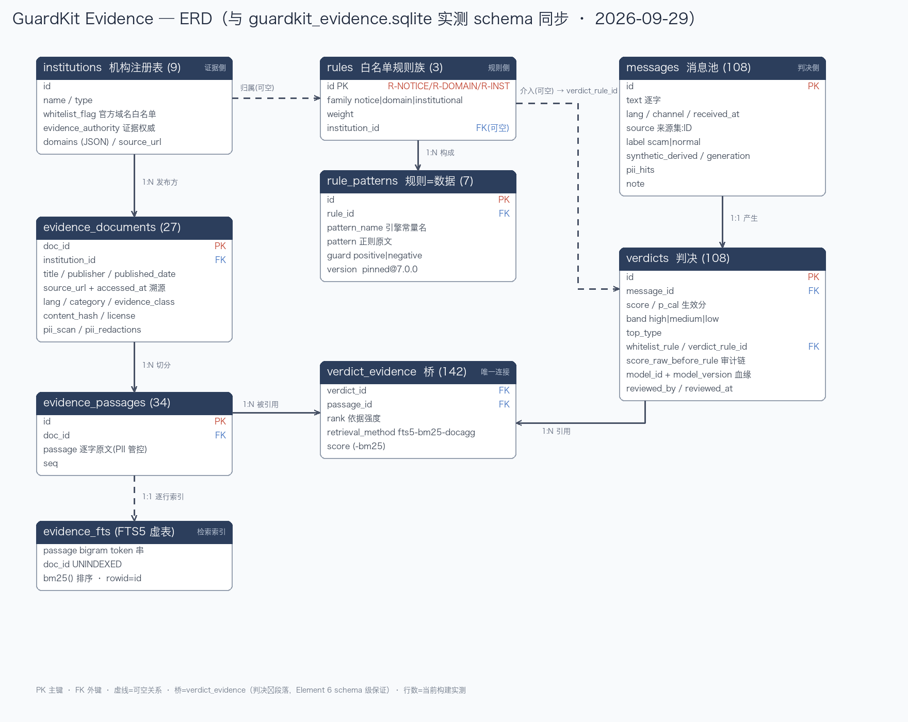

# GuardKit Evidence

An evidence-grounded triage product for suspicious payment messages in Hong Kong.

Each incoming SMS or WhatsApp payment instruction is scored, checked against a whitelist of genuine institutional notices, and matched to the official advisory passage that supports the assessment. The result is a verdict card. High-risk messages are escalated to a person. The system never blocks a payment by itself.

## How it works

1. **Score.** A pinned n-gram scoring engine (`engine/scorer.py`, weights in `models/radar.json`) turns a message into a calibrated risk score and a best-guess scam type. Three whitelist rule families (official notice wording, official domains, institutional notices) suppress genuine bank and government messages.
2. **Retrieve.** SQLite FTS5 with character bigrams and BM25 ranks the official passages that match the message. Passage scores are aggregated per document, so the best passage comes from the best document.
3. **Explain.** A verdict card shows the score, the band, the rule that fired and the official passage word for word, with its title, URL and access date. If nothing relevant is found, the card says so instead of forcing a citation.
4. **Escalate.** High-risk cases go to a human reviewer. Nothing is blocked automatically.

Everything runs on the Python standard library (Python 3.9 or later). The database is a single SQLite file with eight tables and one FTS5 index. `verdict_evidence` links every verdict to the exact passage it relied on, so "which official sentence backs this verdict?" is one SQL join.



A verdict card for a supplier-bank-account-change message looks like this:

```
Verdict card · MSG-001                                       HIGH RISK
Risk score (calibrated): 1.00 / 1.00
Why suspicious: impersonation · requests an account change · names a new account · urgency
Evidence: Hong Kong Police Force (Offbeat), 商業電郵騙案｜如何避開商業電郵騙案？5大常見作案手法大公開
          police.gov.hk/offbeat120/scam4/4-business-email-scams.html · accessed 2026-09-29
Action: stop the payment and verify through a previously known channel; case escalated to a person
```

## Quick start

The scoring engine is self-contained and runs as is:

```bash
python tests/test_parity.py      # snapshot check of the pinned engine: PASS 5/5
```

```python
from engine import scorer

model = scorer.load_model("models/radar.json")
score = scorer.make_scorer(model)

# a supplier asking for payment to a new bank account (the project's demo message)
message = ("May你好，我係恆達五金阿強。我哋公司換咗收款戶口，上個月嗰批貨尾數HK$85,000請今日內轉去新戶口"
           "123-456-789，舊戶口因審計已停用，有疑問回覆呢個號碼。")
pred, probs, p_cal, p_raw = score(message)
# pred = "scam", p_cal = 1.000, p_raw = 0.986
# probs = {"bait": 0.186, "impersonation": 0.496, "normal": 0.014, "pay_first": 0.304}
```

Building the database and the verdict cards needs the project dataset, which is not included (see [Data](#data)). With the data in place:

```bash
python src/build_db.py                                   # build guardkit_evidence.sqlite from data/
python src/run_demo.py                                   # score all messages, link evidence, write verdict cards
python tests/test_parity.py                              # engine snapshot check
sqlite3 guardkit_evidence.sqlite < docs/queries.sql      # six business queries
```

## Results

Measured on the project dataset (105 real labelled messages, 27 official documents).

| | |
|---|---|
| Messages | 108 (105 real + 3 demo); 42 scam / 63 normal |
| Languages | zh-HK 36 · en 36 · mixed 18 · zh 15 |
| Evidence documents | 27, split into 34 passages, from 9 institutions |
| Database | 8 tables + an FTS5 index; 108 verdicts, 142 verdict–evidence links |
| Verdicts with evidence | 84; 12 whitelist releases; 12 with no relevant evidence |
| Scam recall (pool) | 40 / 43 |
| Evaluation set | 60 cases, all real: 25 / 28 scam recall, 46 / 60 correct |
| Engine baseline | 229 / 240 scam recall pooled over 17 blind-test volumes; 84.2% on the hardest one (the 2025 CyberDefender set) |

## Evaluation

The evaluation set has 60 real cases, 30 regular and 30 difficult, chosen deterministically by `evaluation/build_60cases.py`. Expected labels come from the labelled pool; observed results are the engine's verdicts.

| stratum | scam flagged | normal released | correct |
|---|---|---|---|
| Regular (30) | 15/15 | 15/15 | 30/30 |
| Difficult (30) | 10/13 | 6/17 | 16/30 |
| Total (60) | 25/28 | 21/32 | 46/60 |

All 14 misses sit in the difficult half and fall into three measured groups:

- **New scams released (3).** The engine is a fixed n-gram model, so a script it has never seen has few matching patterns.
- **Ads and chat flagged (11).** Promotional and dialogue texts read, on the surface, like fraud.
- **Government press texts flagged (4).** A new exposure found by this evaluation and recorded as unresolved.

Files: `evaluation/60cases.csv`, `evaluation/60cases-summary.txt`, `evaluation/fp-attribution.md` (false-positive attribution across 17 volumes), `evaluation/baseline-v7-public-allsets.json` (per-volume baseline).

## Repository layout

| Path | Content |
|---|---|
| `src/` | `build_db.py` (ingestion), `run_demo.py` (scoring, retrieval, verdicts), `textproc.py` (PII scan, bigrams) |
| `engine/scorer.py` | Pinned scoring engine, consumed read-only |
| `models/radar.json` | Engine weights |
| `data/` | Source register (27 documents), institution registry, two data notes. Raw texts are not included, see Data |
| `tests/` | Engine snapshot guard and its vectors |
| `docs/` | `design.md` (ERD, lineage and retrieval notes), `data-dictionary.md`, `governance.md`, `queries.sql` (six business queries), `assets/` |
| `evaluation/` | 60-case evaluation set and summary, `build_60cases.py`, false-positive attribution, 17-volume baseline |
| `GuardKit_Evidence.ipynb` | Step-by-step walkthrough of the whole pipeline (stored outputs removed; it needs the dataset to run) |

## Data

**Included**

- `data/source-register.csv`: 27 official documents from the HKMA, the Hong Kong Police Force (CyberDefender and Offbeat), the HKSAR Government, HSBC, Chiyu Bank and Shanghai Commercial Bank. Each row records the source URL, access date, content hash, category and a licence note.
- `data/institutions.json`: the institution registry that seeds the whitelist.
- `data/DATA-HANDOFF.md` and `data/MESSAGES-SPEC.md`: how the data was collected, labelled and checked, and the specification used for message collection.

**Not included, and why**

- The verbatim evidence passages. They are copyrighted by the publishing institutions (the Hong Kong Police Force copyright notice, for example, prohibits distribution to the public without prior authorisation). They are cited by URL and access date only.
- The message texts. They contain personal data from public phishing corpora.
- `src/seed_evidence.json`: two official documents (Hong Kong Police Force, HKMA) quoted verbatim, for the same reason as the evidence passages.

Both are available from the authors on request for non-commercial research. Without them `src/build_db.py` cannot run; the scoring engine, its tests, the schema and the evaluation results do not depend on them.

Every message in the dataset is real and carries a source label (`<set>:<id>`); no rows are synthetic.

## Scoring engine

The scoring engine was written by Zhanjian Li before this project as part of [GuardKit](https://github.com/P3NN4L/GUARDKIT), an on-device anti-fraud scoring system. This repository consumes it as a pinned dependency: the code in `engine/scorer.py` and the weights in `models/radar.json` are not modified here (only the module docstring was reworded), and `tests/test_parity.py` fails if their behaviour changes. The engine keeps its own licence; see [License](#license).

## Contributors

- Jie Cheng
- Dekang Lu
- Shiyu Zhong
- Yixuan Liu
- Zhanjian Li

## License

The code in this repository is released under the [MIT License](LICENSE), with one exception.

`engine/scorer.py` and `models/radar.json` are the GuardKit scoring engine and its weights, © Zhanjian Li (P3NN4L). They are **not** covered by the MIT License. They are included here as a pinned dependency under the [GuardKit licence](https://github.com/P3NN4L/GUARDKIT/blob/main/LICENSE.txt): free for personal and non-commercial use; commercial use requires a separate paid licence.
