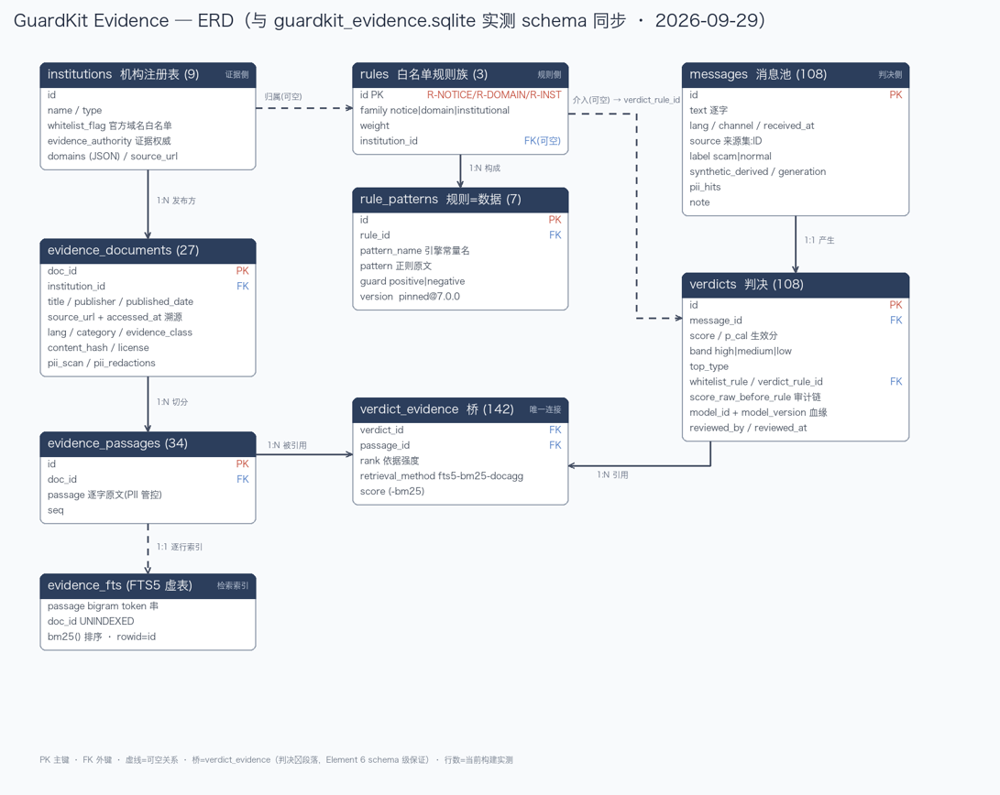
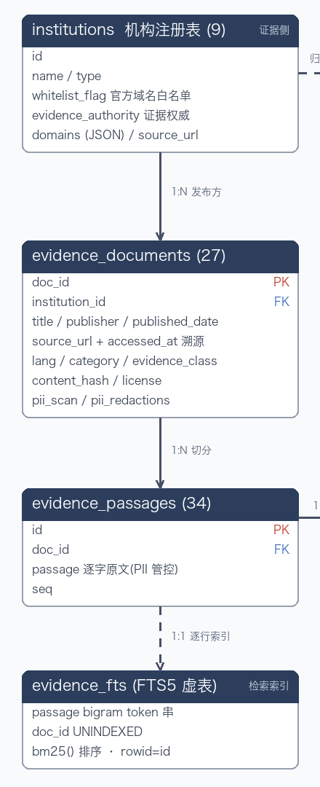
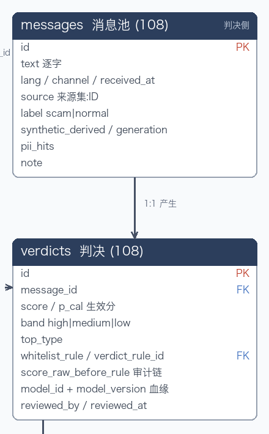
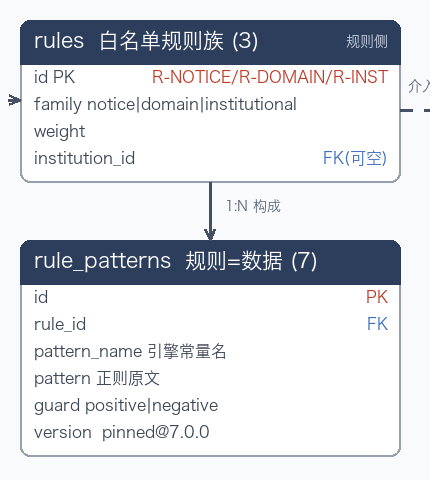
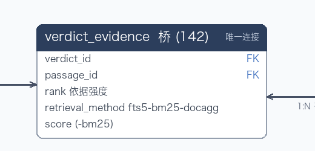
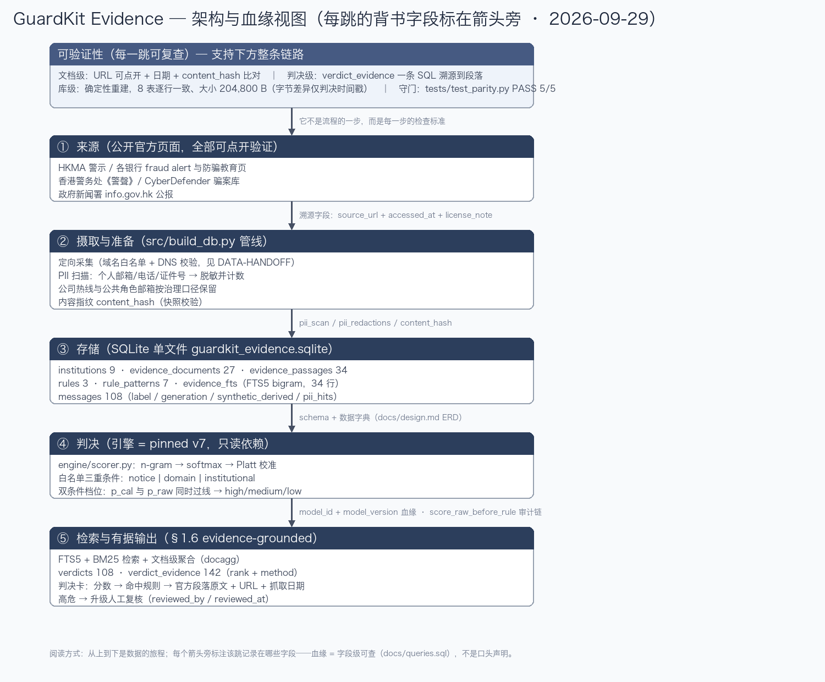

# ERD 详解 · 两张图一块一块讲（组内教学 · 看完能答"为什么是这个关系"）

> 用法：开着 `docs/assets/erd.png`（字段版）和 `docs/assets/lineage.png`（血缘）对照读，本文把两张图裁成小块逐块讲。
> 每个关系都回答三件事：**这个关系是什么 → 为什么非这样不可 → 答辩时怎么用**。
> 读完的检验标准：随便指着图上一条线，你都说得出"它防的是什么错/它支撑的是什么业务问题"。

---

## 〇、为什么有两张图（它们不是重复的）

| | `erd.png` 字段版 ERD | `lineage.png` 血缘视图 |
|---|---|---|
| 回答的问题 | 数据库**长什么样**（表/字段/键/基数） | 数据**怎么流动**（来源→摄取→存储→判决→输出） |
| 学科名字 | 静态结构（概念模型→物理 schema） | 动态过程（lineage 血缘） |
| 课程依据 | §2.4 "Design artefacts: **ERD or schema**" | §2.4 同句要求 "**architecture and lineage view**" + §1.6 "path from source … to output" |
| 答辩用途 | "为什么这个字段/这个键" | "这个结果从哪来" |

老师要的是**两个**交付物，因为静态和动态回答不同问题：ERD 讲"判决凭什么可信"（结构保证），血缘讲"这个判决从哪来"（过程保证）。缺一个都答不全。

**全景先看一眼**（后面逐块放大讲）：

---

## 一、证据侧（绿）：三张表、两条 1:N

### institutions → evidence_documents（1 : N，发布方/所属）

**是什么**：每份证据文档必须挂在一个机构名下（`institution_id` 外键，NOT NULL——没有"无主"的证据）。

**为什么**：一条证据的可信度 = **发布方的权威性**。警务处的防骗指引和某个论坛帖子，对判决的支撑力完全不同。把证据挂到机构，就回答了 marker 必问的"这条依据谁发的、凭什么信它"。配套的 `evidence_authority` 字段（监管/警务/政府=1）让"只要官方权威机构的证据"成为一条可查询的过滤条件（`docs/queries.sql` Q6）。

**答辩一句话**：证据不是孤立的文本，是"某权威机构在某天发布的言论"——归属关系就是可信度的来源。

### evidence_documents → evidence_passages（1 : N，切分为段落）

**是什么**：一份通告拆成若干段逐字原文（`seq` 记段序），**判决引用的最小单位是段落，不是文档**。

**为什么**：这是整个 schema 里最刻意的一个决定。如果判决只连到"整份文档"，会出现两种含糊：① 引用变得粗糙——"依据是某文档"而不是"依据是**这句话**"；② 更糟的是给"整篇文档里某处恰好提过"式的硬凑留了门。落到段落级，`verdict_evidence` 里那条引用就是精确到句子级别的，答辩时当场可念原文。

**为什么段落文本直接进表，而不是在 JSON 层引用**：JSON 层（`data/*.jsonl`）是**采集格式**——原文保真、字段灵活；数据库是**查询格式**——要能 JOIN、能检索。原文入库是为了"一条 SQL 走到原文"，两层分工不同，不是重复存储。

### evidence_fts 为什么不在 ERD 里当实体

图里没有 `evidence_fts`（FTS5 虚表），这是对的：**索引是实现细节，不是业务实体**——概念模型里只画"存在什么业务对象、什么关系"。FTS5 的 `rowid` 与 `evidence_passages.id` 一一对应，只是让检索快、排序用内置 bm25()。它在血缘图里出现（检索那一跳），因为那是**流程**；在 ERD 里省略，因为那是**实现**。同理各表的次要字段（channel/note/reviewed_by…）在 ERD 里有、讲解时略过，完整清单看 `docs/data-dictionary.md`。

---

## 二、判决侧（红）：三张表、三条线

### messages → verdicts（1 : 1）

**是什么**：每条消息**只有一份现行判决**（`verdicts.id` = `V-`+消息 ID）。

**为什么**：判决是消息的**当前结论**，重跑演示时用 `INSERT OR REPLACE` 覆盖——保证"同一条消息永远只有一份生效判决"，脚本重跑多少遍都不会堆出重复行（幂等）。那"历史判决"丢了吗？没有丢东西：① 评测的历史版本在 `evaluation/`（基线与归因）；② 产品库要的是"现在这条消息该被怎么对待"——这是分流产品的业务语义，不是审计日志。审计关心的是**单个判决内部的链路**（见下一条）。

### verdicts 里的审计三件套：score / score_raw_before_rule / verdict_rule_id

**为什么 `score_raw_before_rule` 要单独存在**：白名单压档会**改写**分数（把像真通知的消息压到可疑档以下）。如果只存生效分，"规则到底压了多少"就永远丢失——审计链断裂。保留压档前的原始分，"白名单放行的消息原本被判多危险"就是一条 SQL 能回答的问题（Q3）。类比：会计改账不改原数，留调账凭据。

**为什么 `verdict_rule_id` 是外键而不是文本**：存文本（如 "institutional"）人能看懂，机器查不了；存外键，"哪条规则在哪个版本介入过哪些判决"变成一条 JOIN（Q4）。规则本身又是 `rule_patterns` 表里的**数据**（正则原文+版本）——规则改了，判决和规则版本能对上号。

### rules + rule_patterns（规则即数据，3 族 + 7 条正则）

**为什么拆成两级**：`rules` 是**族**（业务语义层：反诈提示/官方域名/机构通知三族，每族一句人话描述）；`rule_patterns` 是**可执行的正则**（引擎层：原文、正/负向 guard、版本号）。两级的好处：报告里讲业务逻辑引用 `rules`，审计与复现引用 `rule_patterns`——"白名单 v4 和 v3 差在哪个正则"这类问题有表可查。

**为什么正则是"投影生成"而不是手抄**：`build_db.py` 建库时从 pinned 引擎（`engine/scorer.py`）**程序化读取**正则写入表——表里的正则**必然**等于引擎实际执行的正则，零漂移。手抄一张表迟早和代码不同步，那才是灾难。

**为什么 `rules.institution_id` 可空**：R-NOTICE（反诈提示族）是全网通用的官方提醒，不归属任何单一银行；R-DOMAIN/R-INSTITUTIONAL 才有归属机构。可空外键表达的就是"这个关系对部分行不存在"——**可空不是偷懒，是业务事实**。

---

## 三、桥（紫）：verdict_evidence，整个 schema 最重要的三行代码

### verdicts → verdict_evidence ← evidence_passages（两个 1 : N 合成一个多对多）

**是什么**：`verdict_evidence` 只有两个外键加三个说明字段（`verdict_id`、`passage_id`、`rank` 强度序、`retrieval_method`、`score`），两列组成复合主键。

**为什么这张表必须独立存在（而不是在 verdicts 里加一列"依据"）**：因为一个判决可能引用**多段**依据（按强度 rank 排序），一段原文也可能支撑多个判决——这是**多对多**，关系模型的标准答案就是拆桥表。复合主键 (verdict_id, passage_id) 同时保证同一判决不会重复引用同一段。

**为什么证据只在非白名单判决落库（当前 142 行 = 84 条判决的证据）**：白名单放行的 12 条判决，其"依据"是**规则**（`verdict_rule_id` 已记录），不需要官方段落；12 条 benign 闲聊**如实不凑依据**。三种去向加起来恰好 108：**84 有证据落库 + 12 规则放行 + 12 如实无检索**——报告必须写明这个三分账，否则数行数会以为缺了 24 条。第三类不是缺陷，恰是课程反对 "unsupported outputs" 的正面示范：**没有依据就不显示依据，宁缺毋假**。

**这条桥为什么是"唯一连接"**：证据侧（机构→文档→段落）和判决侧（消息→判决）各自成链，**只有** `verdict_evidence` 把两岸连起来。这就是 Element 6 "traceable evidence is compulsory" 的 schema 级落地——可追溯不靠应用层临场发挥，靠外键约束保证存在。判决卡显示的每段原文，都能用 `docs/queries.sql` Q1 的一条 SQL 走到底：判决 → 桥 → 段落 → 文档 → URL + 抓取日期。

---

## 四、血缘图（第二张 ERD）：数据的一生

血缘图把**同样的表**放进**时间顺序**里读，五段：

1. **来源**：全部是公开官方页面（HKMA/银行/警务处/政府公报），没有一处"我们从记忆里写的"。
2. **摄取**：采集带域名白名单与 DNS 校验（防钓鱼站混入）；**PII 扫描**（个人邮箱/电话/证件号脱敏计数，公司热线作为通告内容保留）；`content_hash` 指纹——每一跳的证明字段都落在表里（`pii_scan`/`pii_redactions`/`content_hash`）。
3. **存储**：就是 ERD 那 8 张表——两张图在此汇合。
4. **判决**：pinned 引擎（`model_id`/`model_version` 记录血缘）+ 白名单 + 双条件档位。
5. **输出**：检索写桥表 → 判决卡（分数→规则→原文）→ 高危升级（`reviewed_by`/`reviewed_at` 等人填）。

顶部"可验证性"横带是血缘图的灵魂（它不是流程的一步，而是每一步的检查标准）：**文档级**（URL+日期+hash 可比对）、**判决级**（桥表一条 SQL 溯源）、**库级**（重建库与提交库逻辑逐行一致、大小 204,800 B；字节差异仅判决时间戳）——三层验证让血缘不是口头声明。

---

## 五、答辩速查：关系类问题一览

| 可能被问 | 一句话答案 | 详在哪节 |
|---|---|---|
| 为什么判决连段落不连文档 | 可信度落到最小单元，防"某处恰好提过"式含糊引用 | 一 |
| 为什么有个桥表 | 判决↔依据是多对多（rank 排序），复合主键防重复引用 | 三 |
| 为什么消息和判决 1:1 | 判决=当前结论，幂等重跑覆盖；历史在 evaluation 层 | 二 |
| 为什么白名单判决没有证据行 | 它的依据是规则本身（verdict_rule_id）；108 = 84+12+12 三分账 | 三 |
| score_raw_before_rule 干嘛的 | 白名单压档前的原始分，审计链（Q3 可查压了多少） | 二 |
| 规则为什么是表不是代码常量 | 可版本化可审计；由 pinned 引擎投影生成防漂移 | 二 |
| FTS5 怎么不在 ERD 里 | 索引是实现细节不是业务实体；在血缘图的检索一跳出现 | 一 |
| institutions 那条虚线为什么可空 | R-NOTICE 反诈提示族不归属单一银行——可空是业务事实 | 二 |
| 证据万一被网站删了怎么办 | URL+日期+hash 三件套快照存档，可复现比对 | 四 |
| 怎么证明依据不是事后编的 | 先归档后判决 + 指纹 + 桥表外键 + 库级可复现，四层 | 三、四 |
